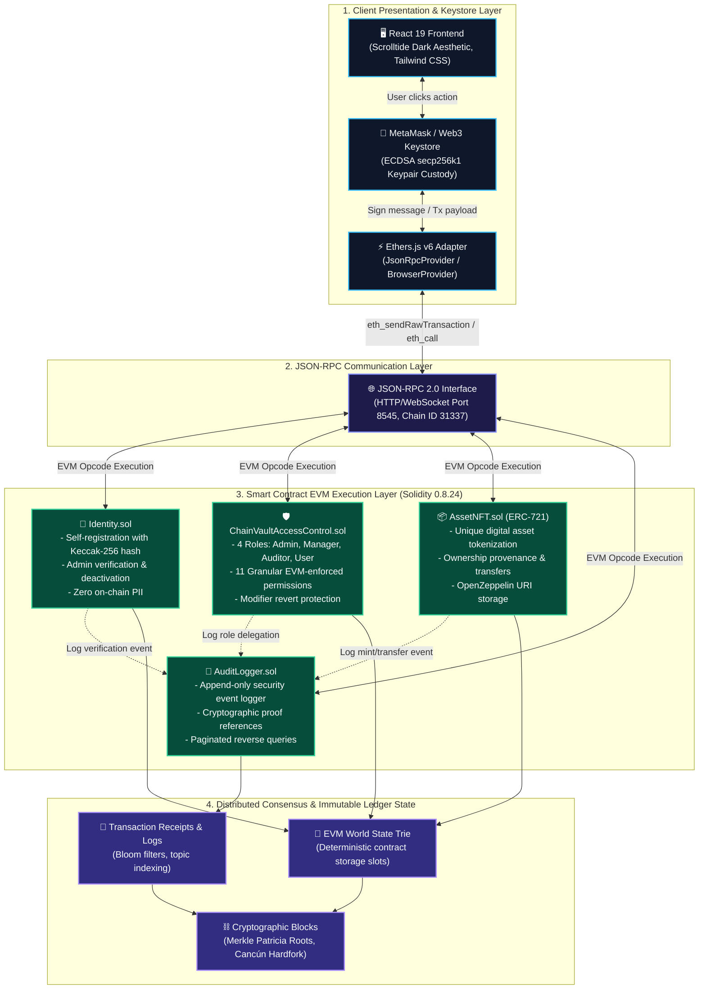
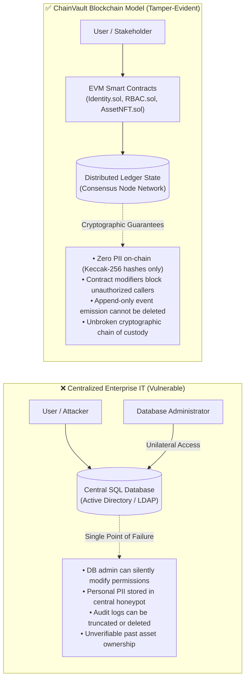
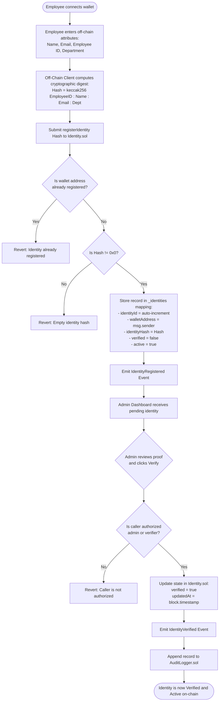
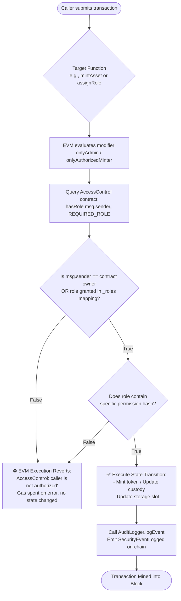
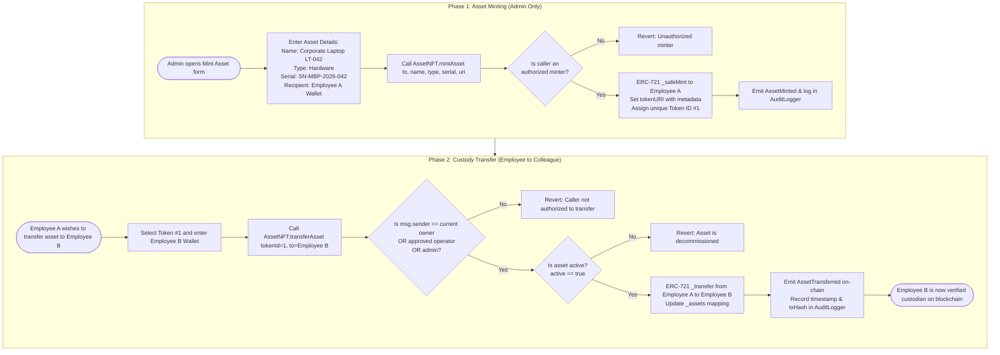
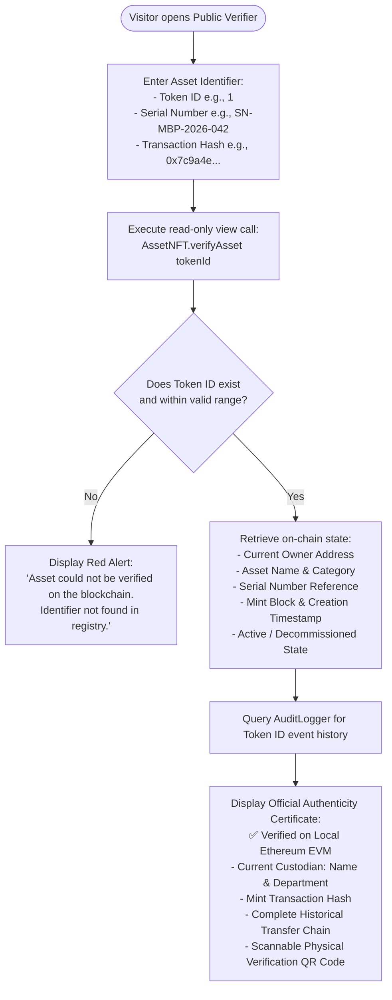
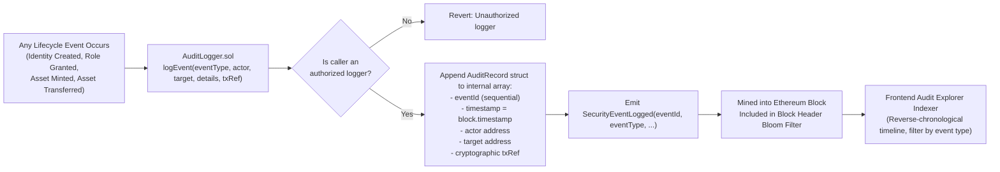
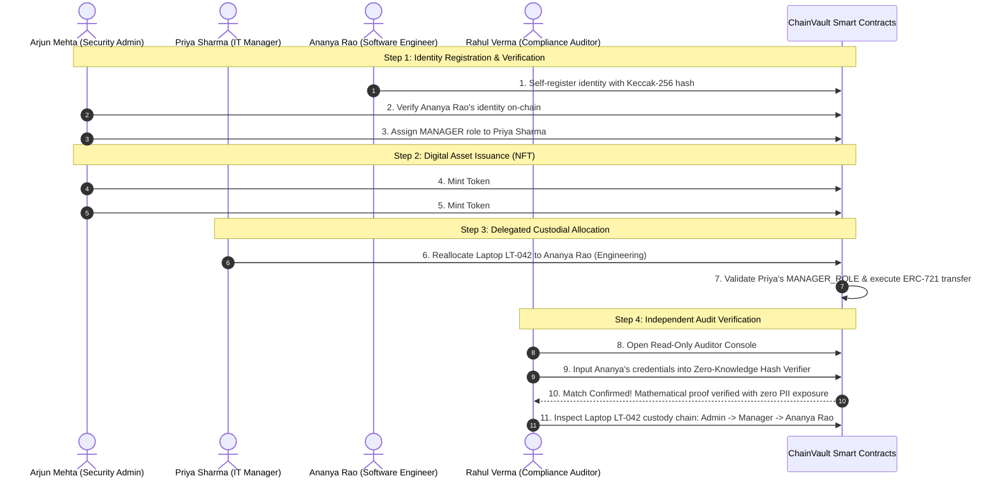
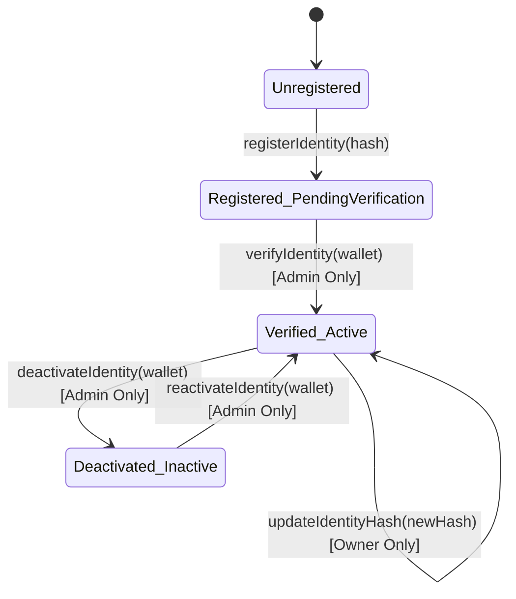
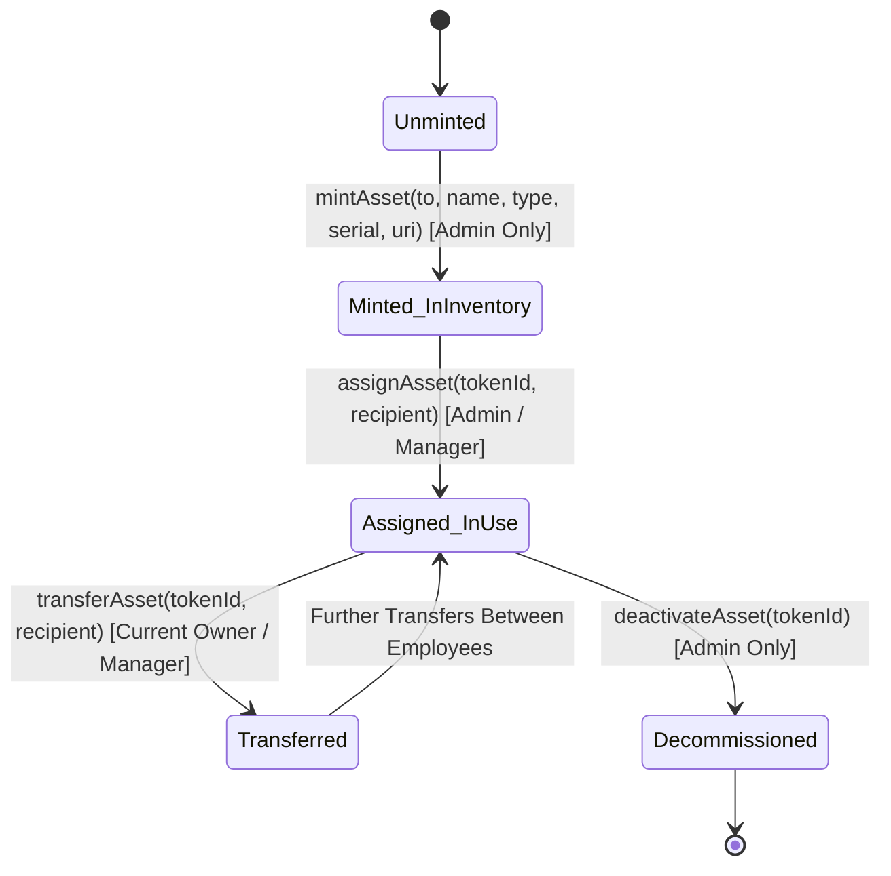

# ChainVault — Complete Visual Architecture & Operational Flowcharts
### *Blockchain-Based Secure Platform for Decentralized Identity, Role-Based Access Control, and Digital Asset Ownership Using Smart Contracts*

---

## 📑 Table of Contents
1. [Visual System Architecture](#1-visual-system-architecture)
2. [Why Blockchain? Centralized vs Decentralized Comparison](#2-why-blockchain-centralized-vs-decentralized-comparison)
3. [End-to-End Functionality Flowcharts](#3-end-to-end-functionality-flowcharts)
   - [Flowchart 1: Decentralized Identity Registration & Hash Verification](#flowchart-1-decentralized-identity-registration--hash-verification)
   - [Flowchart 2: On-Chain Role-Based Access Control (RBAC) Enforcement](#flowchart-2-on-chain-role-based-access-control-rbac-enforcement)
   - [Flowchart 3: Digital Asset (ERC-721 NFT) Minting & Custody Transfer](#flowchart-3-digital-asset-erc-721-nft-minting--custody-transfer)
   - [Flowchart 4: Public Asset Authenticity Verification (No Wallet Required)](#flowchart-4-public-asset-authenticity-verification-no-wallet-required)
   - [Flowchart 5: Immutable Audit Logging & Event Mining Pipeline](#flowchart-5-immutable-audit-logging--event-mining-pipeline)
   - [Flowchart 6: Real-World Enterprise Scenario (Step-by-Step)](#flowchart-6-real-world-enterprise-scenario-step-by-step)
4. [Smart Contract State Transition Diagrams](#4-smart-contract-state-transition-diagrams)
5. [Security Architecture & Defense-in-Depth](#5-security-architecture--defense-in-depth)
6. [Academic Boundaries & Technical Limitations](#6-academic-boundaries--technical-limitations)
7. [Examiner & Evaluator Viva Q&A Guide](#7-examiner--evaluator-viva-qa-guide)

---

## 📌 Project Problem Statement & Scope

> **Background:**  
> Organizations today rely heavily on centralized identity and access management systems, which create significant security and operational risks. These systems are vulnerable to cyber attacks, identity theft, unauthorized access, and single points of failure. Additionally, digital and physical asset ownership is often managed through disconnected or semi-centralized systems, making verification of authenticity, access rights, and ownership history difficult and unreliable. There is a growing need for a decentralized, tamper-proof system that can securely manage user identities, control access permissions, and ensure transparent ownership of digital assets.

> **Detailed Description:**  
> The system introduces a blockchain-based framework that integrates decentralized identity management, access control, and NFT-based digital asset ownership. Each user is assigned a decentralized identifier authenticated using cryptographic proofs. Digital assets are represented as Non-Fungible Tokens (NFTs), permanently recorded and directly allocated to user identities. Smart contracts govern all operations, allowing only authorized administrators to mint NFTs and assign them to user identities. The system implements Role-Based Access Control (RBAC) with Admin, Manager, Auditor, and User roles enforced by smart contracts. Every activity is immutably recorded on the blockchain, providing a transparent, tamper-proof audit trail.

> **Expected Solution:**  
> A unified, trustless decentralized platform integrating secure digital identity management, NFT-based asset ownership, and access control governed by smart contracts on an immutable blockchain ledger.

---

## 1. Visual System Architecture

The following diagram illustrates how the frontend user interface, wallet key custody, EVM smart contracts, and distributed ledger state communicate in real time:



---

## 2. Why Blockchain? Centralized vs Decentralized Comparison



---

## 3. End-to-End Functionality Flowcharts

### Flowchart 1: Decentralized Identity Registration & Hash Verification

How an employee registers their identity without ever exposing sensitive personal information on a public blockchain:



---

### Flowchart 2: On-Chain Role-Based Access Control (RBAC) Enforcement

How permissions are validated mathematically by the EVM on every invocation:



---

### Flowchart 3: Digital Asset (ERC-721 NFT) Minting & Custody Transfer

How corporate hardware (e.g., Laptop LT-042) and digital licenses are minted and transferred between colleagues:



---

### Flowchart 4: Public Asset Authenticity Verification (No Wallet Required)

How external auditors, employees, or third parties verify genuine ownership without needing MetaMask or gas:



---

### Flowchart 5: Immutable Audit Logging & Event Mining Pipeline

How security and governance actions become permanent, tamper-evident audit trails:



---

### Flowchart 6: Real-World Enterprise Scenario (Step-by-Step)

A complete demonstration scenario showing how the four pre-configured stakeholders interact:



---

## 4. Smart Contract State Transition Diagrams

### 4.1 Identity State Machine ([Identity.sol](file:///d:/Varun/BCT/contracts/Identity.sol))


### 4.2 Asset Custody State Machine ([AssetNFT.sol](file:///d:/Varun/BCT/contracts/AssetNFT.sol))


---

## 5. Security Architecture & Defense-in-Depth

| Layer | Threat / Attack Vector | ChainVault Mitigation Mechanism |
| :--- | :--- | :--- |
| **Data Privacy** | Public ledger inspection leaking employee personal data | **Zero PII On-Chain:** Off-chain attributes are passed through `keccak256`. Only the 32-byte digest is committed to `Identity.sol`, ensuring GDPR Article 17 compliance. |
| **Authorization** | Bypassing frontend UI to invoke administrative methods directly | **EVM Modifier Checks:** Methods use `onlyAdmin` and `onlyAuthorizedMinter`. Unauthorized callers revert at the bytecode level, as verified by our 19-test automated test suite. |
| **Reentrancy** | Recursive reentrant calls draining state during transfers | **OpenZeppelin `ReentrancyGuard`:** State-changing methods declare `nonReentrant` following the *Checks-Effects-Interactions* design pattern. |
| **Asset Burning** | Unintentional transfer to zero-address (`0x000...000`) | **Zero-Address Guards:** Explicit `require(to != address(0))` validations before any mint or transfer operation. |
| **Audit Tampering** | Deleting or altering past security logs | **Append-Only Array:** `AuditLogger.sol` provides no deletion or modification functions; records can only be pushed. |

---

## 6. Academic Boundaries & Technical Limitations

When presenting to professors, reviewers, or examiners, explicitly highlight these boundaries to demonstrate technical maturity:

1. **Wallet Keypair ≠ Full W3C DID Standard:**  
   An Ethereum public key acts as an authoritative cryptographic keypair. A full W3C Decentralized Identifier standard requires JSON-LD DID Documents (`did:ethr:...`) and decentralized resolution endpoints.
2. **NFT Ownership ≠ Physical Asset Condition:**  
   The ERC-721 token proves ownership of the organizational digital record. It does not prove that a physical laptop is undamaged or physically present in an office. External mechanisms (QR codes, serial tags, RFID, physical audits) are required.
3. **Private Key Custody Risk:**  
   Decentralized security relies on private key security. If an employee loses access to their private key, their account must be revoked and re-enrolled by an administrator.
4. **Gas & Scalability on Public Networks:**  
   Running enterprise access control on public Ethereum L1 would incur prohibitive gas fees. In commercial production, this architecture is deployed on **private consortium chains** (Hyperledger Besu, Quorum) or **Layer-2 Rollups** (Arbitrum Orbit, Polygon CDK).

---

## 7. Examiner & Evaluator Viva Q&A Guide

### Q1: "Why is a blockchain needed for IAM when relational databases with RBAC already exist?"
> **Answer:** "Centralized databases rely entirely on trusting database administrators and have a single point of failure. If root DB credentials are breached, an attacker can modify permission rows without producing cryptographic evidence. ChainVault turns access control into smart contract execution: permissions are enforced on the EVM, and every change generates an immutable, timestamped transaction proof."

### Q2: "How does ChainVault comply with privacy regulations like GDPR if blockchain records cannot be deleted?"
> **Answer:** "ChainVault enforces a strict **Zero PII on-chain** design. Sensitive details (legal names, personal emails, employee IDs) are hashed locally on the client using Keccak-256. Only the 32-byte hash is stored on-chain. An external observer cannot reverse the hash to recover personal identity, but an authorized auditor can mathematically confirm an identity claim."

### Q3: "What prevents an unauthorized employee from calling `mintAsset` directly via curl or Hardhat?"
> **Answer:** "Security is enforced at the smart contract level, not by hiding buttons in the UI. `AssetNFT.sol` checks `msg.sender` inside the `onlyAuthorizedMinter` modifier. If the caller does not hold the `ADMIN` role in `ChainVaultAccessControl.sol`, the EVM automatically reverts the transaction and burns gas, as proven in our automated test suite."

### Q4: "How does the platform support evaluations if MetaMask is not installed on the evaluator's machine?"
> **Answer:** "ChainVault features a built-in **Interactive Demo Mode** pre-loaded with four enterprise personas (Arjun Mehta as Admin, Priya Sharma as Manager, Rahul Verma as Auditor, Ananya Rao as User). It simulates transactions and state transitions in-memory with full cryptographic hashing, clearly marked by an amber banner: *'DEMO MODE — Blockchain transactions are simulated'*."

---

## 8. Automated Test Suite Proofs

All contract operations and security assertions are validated by a 19-test automated test suite:

```bash
npx hardhat test test/ChainVault.test.js
```

```
  ChainVault Security Platform — Smart Contract Test Suite
    1. Decentralized Identity
      ✔ Should allow a wallet to self-register an identity with a cryptographic hash
      ✔ Should reject duplicate registration for the same wallet
      ✔ Should reject registration with empty identity hash
      ✔ Should allow authorized verifier to verify an identity
      ✔ Should prevent unauthorized wallets from verifying identities
      ✔ Should allow identity owner to update their off-chain identity hash
      ✔ Should allow authorized admin to deactivate and reactivate an identity
    2. On-Chain Role-Based Access Control (RBAC)
      ✔ Deployer has ADMIN role by default
      ✔ Admin can assign roles with granular permissions
      ✔ Non-admin cannot assign roles (Smart Contract enforcement)
      ✔ Admin can revoke roles and their default permissions
      ✔ Admin can grant and revoke bespoke granular permissions
    3. Digital Asset Management (ERC-721 NFT)
      ✔ Authorized minter can mint asset NFT with complete metadata
      ✔ Unauthorized account CANNOT mint asset NFTs
      ✔ Owner or admin can assign / transfer asset to another identity
      ✔ Unauthorized account CANNOT transfer someone else's asset
      ✔ Asset verification returns correct on-chain status
    4. Immutable Audit Logging
      ✔ Authorized logger can record security events
      ✔ Non-authorized caller cannot write to audit logger

  19 passing (2s)
```
