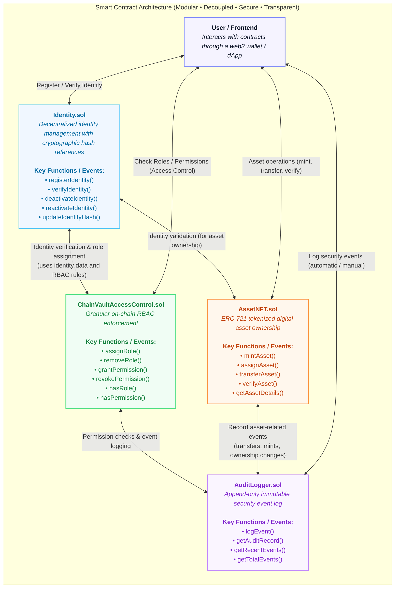

# ChainVault — Blockchain-Based Secure Platform for Decentralized Identity, Role-Based Access Control, and Digital Asset Ownership

> **Academic Problem Statement:**  
> *"Blockchain-Based Secure Platform for Decentralized Identity, Role-Based Access Control, and Digital Asset Ownership Using Smart Contracts"*

> 📖 **Comprehensive Presentation & Viva Guide:** See [PRESENTATION_README.md](file:///d:/Varun/BCT/PRESENTATION_README.md) for full Mermaid state diagrams, step-by-step functionality flows, security defense-in-depth aspects, and examiner Q&A cheat sheet.

---

## 1. Problem Statement & Executive Summary

### 1.1 Background
Organizations today rely heavily on centralized identity and access management systems, which create significant security and operational risks. These systems are vulnerable to cyber attacks, identity theft, unauthorized access, and single points of failure. Additionally, digital and physical asset ownership is often managed through disconnected or semi-centralized systems, making verification of authenticity, access rights, and ownership history difficult and unreliable. There is a growing need for a decentralized, tamper-proof system that can securely manage user identities, control access permissions, and ensure transparent ownership of digital assets.

### 1.2 Detailed Description
The system aims to introduce a blockchain-based framework that integrates decentralized identity management, access control, and NFT-based digital asset ownership:
- **Decentralized Identifiers (DID):** Each user is assigned a decentralized identifier, which serves as a secure and verifiable digital identity independent of centralized authorities and authenticated using cryptographic proofs.
- **NFT-Based Asset Ownership:** Digital assets are represented as Non-Fungible Tokens (NFTs), ensuring each asset is unique, traceable, and permanently recorded on the blockchain. These NFTs are directly allocated to user identities, establishing verifiable ownership that cannot be altered or duplicated.
- **Smart Contract Governance:** Smart contracts govern all operations within the platform, allowing only authorized administrators to mint NFTs and assign them to user identities, ensuring controlled asset creation and secure distribution.
- **Role-Based Access Control (RBAC):** The system implements RBAC, where administrators define roles such as **Admin**, **Manager**, **Auditor**, and **User**, and assign specific access rights to each identity. These permissions are enforced automatically by smart contracts during all operations.
- **Immutable Audit Trail:** Every activity, including identity creation, NFT creation, asset allocation, access rights assignment, ownership transfers, and permission updates, is immutably recorded on the blockchain, providing a transparent and tamper-proof audit trail for verifying ownership, authenticity, and access history.

### 1.3 Expected Solution & System Implementation Alignment

The implemented platform delivers this unified, trustless solution through four coordinated smart contracts:

| Requirement Area | Problem Statement Objective | Implemented Solution in ChainVault | Contract / Module |
| :--- | :--- | :--- | :--- |
| **Decentralized Identity** | Self-sovereign, cryptographically verifiable identities free from central authorities | Web3 wallet addresses paired with Keccak-256 identity digests (`bytes32 identityHash`) storing zero on-chain PII | [`Identity.sol`](contracts/Identity.sol) |
| **Granular RBAC** | Define Admin, Manager, Auditor, User roles with automatic smart contract enforcement | On-chain role registry with 4 roles and 11 granular permissions enforced at the EVM execution level via function modifiers | [`ChainVaultAccessControl.sol`](contracts/ChainVaultAccessControl.sol) |
| **NFT Digital Assets** | Unique, traceable, immutable ownership permanently linked to user identities | OpenZeppelin ERC-721Enumerable & ERC721URIStorage tokens with strict minter access control and transfer validation | [`AssetNFT.sol`](contracts/AssetNFT.sol) |
| **Governance & Minting** | Controlled asset creation allowing only authorized admins to mint and allocate | Admin-only minter verification modifiers preventing unauthorized duplication or reassignment | [`AssetNFT.sol`](contracts/AssetNFT.sol) & [`ChainVaultAccessControl.sol`](contracts/ChainVaultAccessControl.sol) |
| **Tamper-Proof Audit Trail** | Transparent, permanent audit logging of all identity, access, and asset operations | Append-only event ledger and indexed EVM receipt topics providing forensic historical auditability | [`AuditLogger.sol`](contracts/AuditLogger.sol) |

---

## 2. Visual Direction — Scrolltide Aesthetic

ChainVault is engineered with a **Scrolltide-inspired enterprise cybersecurity aesthetic**:
- Deep obsidian and midnight palettes (`#04060a`, `#080c14`, `#0c1220`)
- Subtle cyan (`#38bdf8`), cobalt, and emerald accents
- HTML5 Canvas interactive particle graph visualizing decentralized nodes, contracts, and transaction packets
- Editorial typography with Google Fonts (*Outfit*, *Inter*, *JetBrains Mono*)
- Multi-stage animated transaction modal (*Preparing → Wallet Signature → Consensus → Finalized with Confetti*)

---

## 3. Technology Stack

### Blockchain & Smart Contracts
- **Solidity:** `^0.8.24` (Cancun EVM target)
- **Hardhat:** `2.22.15`
- **OpenZeppelin Contracts:** `v5.0` (`Ownable`, `ReentrancyGuard`, `ERC721`, `ERC721Enumerable`, `ERC721URIStorage`)
- **Ethers.js:** `v6.13.4`
- **Testing:** Mocha, Chai

### Frontend
- **Framework:** React 19, Vite, TypeScript
- **Styling:** Tailwind CSS, PostCSS, Autoprefixer
- **Visuals & Icons:** Lucide React, Canvas Confetti, HTML5 Canvas Network Graph
- **State Management:** Reactive Singleton Service with LocalStorage persistence and automatic Hardhat RPC / MetaMask detection

---

## 4. Smart Contract Architecture
> **Modular • Decoupled • Secure • Transparent**

The platform employs a modular, decoupled smart contract architecture designed for role segregation, data integrity, and decentralized auditability.


### Architectural Interaction Diagram



### Contract Specifications & Key Functions

| Contract | Description & Responsibilities | Key Functions / Events |
| :--- | :--- | :--- |
| **`Identity.sol`** | Decentralized identity management with cryptographic hash references | `registerIdentity()`, `verifyIdentity()`, `deactivateIdentity()`, `reactivateIdentity()`, `updateIdentityHash()` |
| **`ChainVaultAccessControl.sol`** | Granular on-chain RBAC enforcement | `assignRole()`, `removeRole()`, `grantPermission()`, `revokePermission()`, `hasRole()`, `hasPermission()` |
| **`AssetNFT.sol`** | ERC-721 tokenized digital asset ownership | `mintAsset()`, `assignAsset()`, `transferAsset()`, `verifyAsset()`, `getAssetDetails()` |
| **`AuditLogger.sol`** | Append-only immutable security event log | `logEvent()`, `getAuditRecord()`, `getRecentEvents()`, `getTotalEvents()` |

### Architectural Component Summary

- **`Identity.sol`**: Manages decentralized identity with cryptographic hash references.
- **`ChainVaultAccessControl.sol`**: Enforces granular RBAC (roles and permissions) on-chain.
- **`AssetNFT.sol`**: Handles ERC-721 tokenized digital asset ownership.
- **`AuditLogger.sol`**: Maintains an immutable log of all critical security events.

---

## 5. Granular RBAC Permissions

| Permission | Description | ADMIN | MANAGER | AUDITOR | USER |
| :--- | :--- | :---: | :---: | :---: | :---: |
| `IDENTITY_VIEW` | Read identity records | ✓ | ✓ | ✓ | ✓ |
| `IDENTITY_VERIFY` | Authorize employee identities | ✓ | — | ✓ | — |
| `IDENTITY_MANAGE` | Deactivate/reactivate identities | ✓ | — | — | — |
| `ROLE_ASSIGN` | Assign roles on-chain | ✓ | — | — | — |
| `ROLE_REVOKE` | Remove assigned roles | ✓ | — | — | — |
| `ASSET_CREATE` | Mint new ERC-721 NFTs | ✓ | — | — | — |
| `ASSET_ASSIGN` | Allocate assets to team members | ✓ | ✓ | — | — |
| `ASSET_TRANSFER` | Transfer custody to colleague | ✓ | ✓ | — | ✓ |
| `ASSET_VIEW` | Query asset specifications | ✓ | ✓ | ✓ | ✓ |
| `AUDIT_VIEW` | Inspect immutable audit ledger | ✓ | ✓ | ✓ | — |
| `SYSTEM_MANAGE` | Platform configuration | ✓ | — | — | — |

---

## 6. Real-World Demonstration Personas

The application includes four pre-configured demonstration personas matching corporate stakeholders:

1. **Arjun Mehta (ADMIN):**  
   - Wallet: `0xf39Fd6e51aad88F6F4ce6aB8827279cffFb92266`  
   - Role: Root Security Administrator (`EMP-001`)  
   - Permissions: Full governance, role assignment, NFT minting, identity verification.

2. **Priya Sharma (MANAGER):**  
   - Wallet: `0x70997970C51812dc3A010C7d01b50e0d17dc79C8`  
   - Role: IT Operations Manager (`EMP-002`)  
   - Permissions: Asset allocation, team equipment management, department transfer.

3. **Rahul Verma (AUDITOR):**  
   - Wallet: `0x3C44CdDdB6a900fa2b585dd299e03d12FA4293BC`  
   - Role: Compliance Auditor (`EMP-003`)  
   - Permissions: Read-only verification, cryptographic hash checking, custody inspection.

4. **Ananya Rao (USER):**  
   - Wallet: `0x90F79bf6EB2c4f870365E785982E1f101E93b906`  
   - Role: Core Software Engineer (`EMP-004`)  
   - Assets: Corporate Laptop LT-042 (NFT #1), ISO/IEC Cert DC-031 (NFT #3).

---

## 7. United Nations Sustainable Development Goals (SDGs)

ChainVault directly aligns with the following UN SDGs:

- **SDG 9 — Industry, Innovation and Infrastructure (Primary):** Establishes secure, vendor-neutral digital infrastructure resilient to single-vendor outages.
- **SDG 16 — Peace, Justice and Strong Institutions (Primary):** Fosters institutional transparency, accountable asset stewardship, and tamper-evident auditability.
- **SDG 8 — Decent Work and Economic Growth (Secondary):** Safeguards organizational intellectual property and high-value hardware custody for distributed workforces.
- **SDG 4 — Quality Education (Secondary):** Verifiable digital credentials and certifications issued via tamper-proof NFTs.

---

## 8. Academic Integrity & Technical Limitations

To maintain academic credibility, the following technical boundaries are explicitly acknowledged:

1. **Wallet Keypairs ≠ Full W3C DIDs:** An Ethereum public address acts as a cryptographic identifier. A full W3C DID standard requires DID documents and decentralized resolution endpoints.
2. **Zero PII on Public Blockchains:** Sensitive employee attributes (names, salaries, personal IDs) must never be written to an immutable public chain. Only unidirectional Keccak-256 hashes are stored.
3. **NFT Ownership ≠ Physical Possession:** An ERC-721 token certifies ownership of the digital record. Verification of physical condition requires external mechanisms (RFID, serial tags, QR verification).
4. **Scalability & Transaction Fees:** High-frequency event throughput on public mainnets requires Layer-2 rollups or enterprise sidechains.

---

## 9. Quickstart Installation Guide

### Prerequisites
- Node.js v18+ or v20+
- npm v9+
- MetaMask browser extension (optional for live chain interaction; simulated Demo Mode functions out-of-the-box)

### Step 1: Install Dependencies
```bash
# Install root Hardhat dependencies
npm install

# Install frontend dependencies
cd frontend
npm install
cd ..
```

### Step 2: Compile & Test Smart Contracts
```bash
# Compile contracts with Solidity 0.8.24 Cancun EVM
npx hardhat compile

# Run the 19-test automated security suite
npx hardhat test test/ChainVault.test.js
```

### Step 3: Run Local Blockchain & Deploy
```bash
# Option A: Deploy to ephemeral in-memory Hardhat network
npx hardhat run scripts/deploy.js

# Option B: Run persistent local node (in a separate terminal)
npx hardhat node
# Deploy contracts to localhost node:
npx hardhat run scripts/deploy.js --network localhost
```

### Step 4: Launch Frontend
```bash
cd frontend
npm run dev
```
Open [http://localhost:5173](http://localhost:5173) in your browser.

---

## 10. Demo Mode vs Production Blockchain Mode

- **Demo Mode:** When no MetaMask extension is detected or when local node is offline, ChainVault operates in interactive Demo Mode with a clear amber indicator. Transactions and state transitions are simulated deterministically in-memory.
- **Production / Localhost Mode:** Connecting MetaMask to network `31337` (RPC `http://127.0.0.1:8545`) sends transactions directly to the deployed smart contracts on your local Hardhat node.

---

## 11. Project Directory Structure

```
├── contracts/
│   ├── Identity.sol                    # Decentralized identity registry
│   ├── ChainVaultAccessControl.sol     # Granular on-chain RBAC
│   ├── AssetNFT.sol                    # ERC-721 digital asset ownership
│   └── AuditLogger.sol                 # Immutable security audit log
├── scripts/
│   └── deploy.js                       # Deployment & demo data seeding
├── test/
│   └── ChainVault.test.js              # 19-test contract test suite
├── frontend/
│   ├── src/
│   │   ├── components/                 # Navbar, Footer, TransactionModal, Canvas
│   │   ├── pages/
│   │   │   ├── LandingPage.tsx         # Scrolltide cinematic landing page
│   │   │   ├── PublicVerifyPage.tsx    # Unauthenticated public asset verifier
│   │   │   ├── AuditTrailPage.tsx      # Immutable audit trail explorer
│   │   │   ├── ExplorerPage.tsx        # Internal EVM transaction ledger
│   │   │   └── dashboards/             # Admin, Manager, Auditor, User dashboards
│   │   ├── services/
│   │   │   ├── blockchain.ts           # Unified Ethers.js & Demo adapter
│   │   │   └── mockData.ts             # Realistic enterprise initial state
│   │   └── types/                      # TypeScript definitions
│   └── package.json
├── hardhat.config.js                   # Hardhat 2 configuration with Cancun EVM
├── .env.example                        # Environment variable template
└── README.md
```

---

## 12. Team & Academic Presentation Information

- **Project:** ChainVault Blockchain Security Platform
- **Course / Domain:** Blockchain Technology (BCT) / Enterprise Cybersecurity
- **Topic:** Decentralized Identity, RBAC & Digital Asset Ownership Using Smart Contracts
- **License:** MIT License
