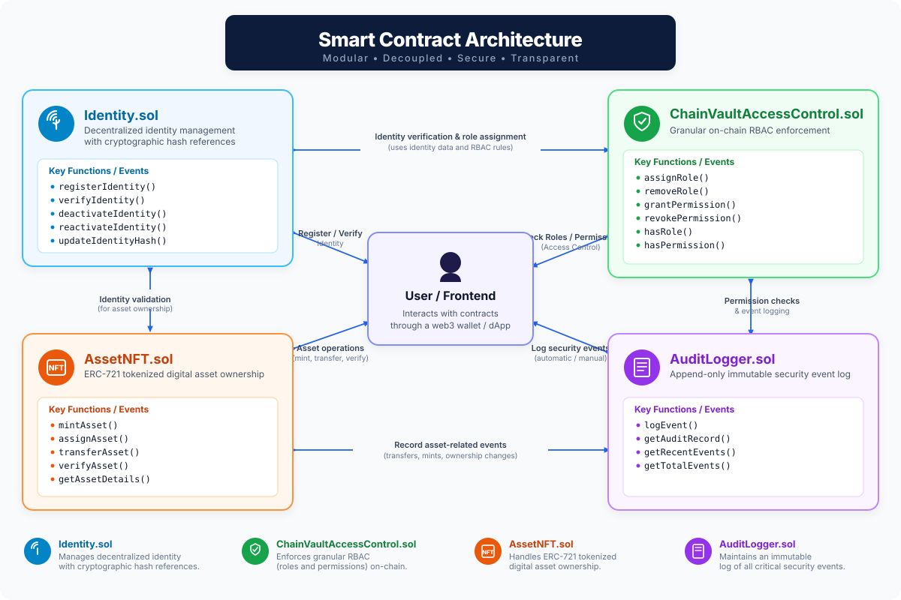

# ChainVault — Technical Architecture & Security Specification

This document provides in-depth technical documentation for the ChainVault decentralized platform, detailing data structures, transaction flows, security guarantees, and smart contract execution logic.

---

## 1. System Overview & Trust Assumptions

ChainVault decomposes enterprise cybersecurity into three core layers:

```
┌──────────────────────────────────────────────────────────────┐
│                  Client Presentation Layer                  │
│       (React 19, TypeScript, Tailwind CSS, Lucide UI)       │
└──────────────────────────────┬───────────────────────────────┘
                               │ Ethers.js v6
┌──────────────────────────────▼───────────────────────────────┐
│              Cryptographic Key Management Layer              │
│       (MetaMask Browser Extension / Local ECDSA Signer)       │
└──────────────────────────────┬───────────────────────────────┘
                               │ JSON-RPC 2.0 (Port 8545)
┌──────────────────────────────▼───────────────────────────────┐
│                  Smart Contract EVM Layer                    │
│  ┌───────────────┐ ┌───────────────┐ ┌────────────────────┐  │
│  │ Identity.sol  │ │ AssetNFT.sol  │ │ AccessControl.sol  │  │
│  └───────┬───────┘ └───────┬───────┘ └─────────┬──────────┘  │
│          └─────────────────┼───────────────────┘             │
│                            ▼                                 │
│                  ┌──────────────────┐                        │
│                  │ AuditLogger.sol  │                        │
│                  └──────────────────┘                        │
└──────────────────────────────┬───────────────────────────────┘
                               │
┌──────────────────────────────▼───────────────────────────────┐
│               Immutable Distributed Ledger State             │
│        (Consensus Engine, Merkle Tries, Event Bloom)         │
└──────────────────────────────────────────────────────────────┘
```

---

## 2. Smart Contract Architecture
> **Modular • Decoupled • Secure • Transparent**



All contracts are written in **Solidity 0.8.24** leveraging **OpenZeppelin 5.0** standard libraries.

### 2.1. `Identity.sol`
Manages identity registration, verification, status deactivation, and cryptographic hash updates.

- **Data Structure:**
  ```solidity
  struct IdentityRecord {
      uint256 identityId;
      address walletAddress;
      bytes32 identityHash;    // keccak256(employeeId:name:email:dept)
      uint256 createdAt;
      uint256 updatedAt;
      bool verified;
      bool active;
  }
  ```
- **Privacy Model:** Sensitive personal data (employee legal name, personal email, phone numbers, national IDs) remains **strictly off-chain**. Only the 32-byte cryptographic digest (`bytes32 identityHash`) is stored on the ledger.
- **Key Invariants:**
  - One identity per wallet address (duplicate registration reverts).
  - Unverified identities cannot perform privileged actions.
  - Deactivated identities immediately forfeit active privileges.

### 2.2. `ChainVaultAccessControl.sol`
Implements on-chain Role-Based Access Control (RBAC) with granular permissions.

- **Roles Defined:**
  - `ADMIN`: Full governance, identity verification, role delegation, NFT minting.
  - `MANAGER`: Department asset allocation and custody tracking.
  - `AUDITOR`: Read-only compliance inspection and hash verification.
  - `USER`: Asset possession, identity review, colleague transfer.
- **Contract Enforcement:** Modifier checks prevent unauthorized transaction execution even if a caller bypasses the frontend and directly invokes smart contract function signatures.

### 2.3. `AssetNFT.sol`
ERC-721 tokenized digital asset management inheriting OpenZeppelin's `ERC721Enumerable` and `ERC721URIStorage`.

- **Data Structure:**
  ```solidity
  struct AssetDetails {
      uint256 tokenId;
      string assetName;
      string assetType;
      string description;
      string serialNumber;
      address createdBy;
      uint256 createdAt;
      bool active;
  }
  ```
- **Custody Transfer:** Only the current token owner, an approved operator, or an authorized admin/manager can execute transfers via `assignAsset()` or `transferAsset()`.

### 2.4. `AuditLogger.sol`
Provides an append-only event ledger capturing critical operations.

- **Data Structure:**
  ```solidity
  struct AuditRecord {
      uint256 eventId;
      string eventType;
      address actor;
      address target;
      string details;
      uint256 timestamp;
      bytes32 txHashReference;
  }
  ```
- **Event Log:** Emits `SecurityEventLogged` allowing external indexing nodes and client interfaces to reconstruct a chronological, tamper-evident audit history.

---

## 3. Transaction Execution Lifecycle

Every transaction in ChainVault undergoes a 4-stage visual and cryptographic state lifecycle:

1. **Preparing:** Client calculates Keccak-256 digests and validates non-zero parameters.
2. **Awaiting Wallet Signature:** The user's MetaMask extension prompts for an ECDSA signature using their secp256k1 private key.
3. **Consensus in Progress:** The transaction is broadcast to the Ethereum node, included in a block, and executed by the EVM.
4. **Finalized:** Event receipts are parsed, block numbers and transaction hashes are displayed, and audit records are appended.

---

## 4. Academic Limitations & Real-World Boundaries

1. **Wallet Keypair vs W3C DID Standard:** A raw Ethereum keypair functions as a cryptographic handle. For full enterprise interoperability, it must be paired with standard W3C DID documents and verifiable credential resolvers.
2. **Off-Chain Identity Secrecy:** Because blockchain storage is immutable and public, GDPR/CCPA "Right to be Forgotten" mandates that zero PII be written on-chain.
3. **Digital Record vs Physical Reality:** An NFT proves that the digital record has been allocated to a specific wallet. It does not provide real-time sensory proof of physical asset condition. Physical integration requires barcode/RFID/QR scanning.
4. **Gas & Scalability:** Deployments on Ethereum mainnet incur variable gas fees. Enterprise deployments typically run on Layer-2 rollups or private consortium chains (e.g., Hyperledger Besu).

---

## 5. Future Engineering Roadmap

- **zk-SNARK Credential Proofs:** Allow employees to prove role authorization or department membership without revealing their public key or employee ID.
- **IPFS Decentralized Storage:** Store encrypted warranty certificates and technical manuals on decentralized file storage.
- **Hardware Enclave Signers:** YubiKey / WebAuthn integration directly producing EVM-compatible signatures.
